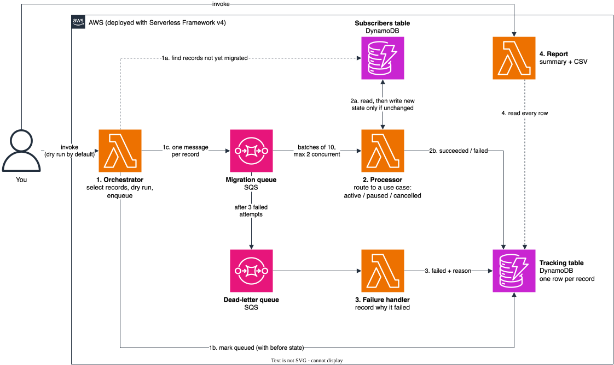
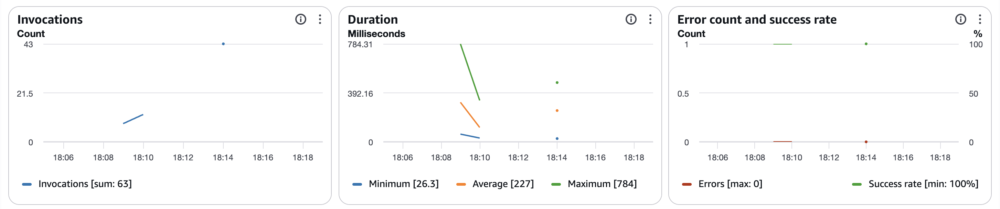

# serverless-data-migration

A serverless pipeline for migrating live records from one data model to another on AWS. It works in batches, is
idempotent and resumable, and verifies its work. Every record ends up tracked as a success or a failure, so nothing
fails silently.

It's based on a production migration I built at a previous job, rewritten here from scratch as a reusable, tested
implementation of the general pattern, with an invented data model. More about my work is on my
[portfolio](https://ahmedalhibshi.dev).

## The problem

Changing a data model under a live product means converting every existing record without downtime, without losing
any record, and without fighting live traffic for capacity. Done by hand, that takes days and goes wrong one record
at a time. Done with a one-off script, failures tend to be invisible, and a run that stops halfway is hard to resume.

## How it works



<sub>Source: [`docs/architecture.drawio`](docs/architecture.drawio). After editing, re-export with
`drawio -x -f svg --svg-theme light -o docs/architecture.svg docs/architecture.drawio`.</sub>

1. **Orchestrator.** It selects the records that still need migrating, optionally narrowed by a filter, a list of
   ids or a limit. In **dry-run mode** (the default) it plans every record and reports what would change, with counts
   per use case, without writing anything. In a live run it tracks each record as queued and enqueues one SQS message
   per record.
2. **Processor.** It reads each record's current state and routes it to the one **migration use case** that applies,
   then writes the new state and tracks the outcome. It reports **partial batch failures**, so only failed messages
   are retried. **Concurrency is capped** at the event source, keeping the migration within DynamoDB limits while
   live traffic continues.
3. **Failure handler.** After three failed attempts, SQS moves a message to the dead-letter queue. This Lambda tracks
   the record as failed with its last recorded error, and falls back to a generic reason when no error was recorded,
   or when the message itself is malformed.
4. **Report.** It lists every record with its outcome, use case, before and after state, and failure reason, as a
   summary plus a CSV that support and product can open in a spreadsheet.

### The worked example

The repo migrates subscribers in an invented, simplified model. Old records have a fixed box size (`small`,
`medium`, `large`) and a bare pause date. New records have a meals-per-week plan and an explicit pause. There are
three use cases:

| Use case               | Applies to            | New state                                                        |
| ---------------------- | --------------------- | ---------------------------------------------------------------- |
| `active-subscriber`    | active subscribers    | equivalent meals-per-week plan                                   |
| `paused-subscriber`    | paused subscribers    | same plan, pause kept until the same date (fails if it has none) |
| `cancelled-subscriber` | cancelled subscribers | no plan                                                          |

### Adding a migration

The pipeline in [`src/migration`](src/migration) doesn't know about subscribers. A migration supplies a `Migration`
definition (see [`types.ts`](src/migration/types.ts)) with:

- a **source repository** that finds pending records, loads one, and saves the new state conditionally;
- its **use cases**, each a class with `appliesTo` and a pure `migrate` method;
- **summaries** of the old and new state, which become the report's before and after columns;
- a Zod **filter schema** for the orchestrator.

[`src/subscriberMigration`](src/subscriberMigration) is the reference implementation.

## Technical decisions

- **Repository pattern.** Entities are Zod schemas with types and the mapping from a stored item. Repositories own
  all DynamoDB access, on a shared base that handles consistent reads, pagination and batch writes with retries. The
  pipeline depends only on repository interfaces, so its logic is unit-tested against in-memory repositories, and
  the DynamoDB repositories are tested against DynamoDB Local.
- **Idempotent by construction.** The source's write is conditional on the record still being in the state it was
  migrated from. A record that's already migrated is a no-op tracked as a success, so SQS's at-least-once delivery
  and re-runs are safe.
- **Optimistic concurrency against live traffic.** If a subscriber changes between read and write, the conditional
  write fails and the message is retried with the latest state. A live change is never overwritten.
- **The whole record is replaced on save.** That's safe here because the example model has no other fields. A real
  model with fields the migration doesn't own would use a conditional update that touches only the migrated fields.
- **Permanent and transient failures are handled differently.** Invalid data, or a record no use case can migrate,
  can't be fixed by retrying. These are tracked as failed straight away. Throttling or a timeout is retried, then
  dead-lettered and tracked with its last error.
- **Resumable without extra state.** The orchestrator selects only records that haven't been migrated, so re-running
  after a stop or a fix picks up exactly what's left. Tracking is keyed by migration and record id, so a re-run
  updates the same rows.
- **Tracked before queued.** Each batch is written to the tracking table before it's sent to SQS, so no message is
  ever in flight for an untracked record.
- **Dry run by default.** A live run needs an explicit `"dryRun": false`, and unknown request fields are rejected,
  so a typo can't silently start a real run.
- **Validated at the edges.** Zod validates the orchestrator's request, every queue message, and every record read
  from the table. Application code has no casts or non-null assertions.
- **Lambda conventions.** Structured JSON logs with the Lambda context via Powertools for AWS Lambda. Environment
  config validated on cold start. Clients created once per container and reused.
- **A safe report.** CSV cells are escaped, and values that a spreadsheet would run as formulas are neutralised.

## Running it locally

Requirements: Node.js 24 and Docker.

```sh
npm install
npm test                    # unit tests
npm run emulators:up        # DynamoDB Local and ElasticMQ (SQS-compatible), in Docker
npm run test:integration    # the full pipeline against the emulators
npm run test:coverage       # both, with coverage thresholds (what CI runs)
npm run emulators:down
```

Other checks: `npm run lint`, `npm run typecheck`, `npm run format:check`. A pre-commit hook runs lint-staged, the
type-check and the unit tests.

The integration tests create their own tables and queues with the AWS SDK, so they need no AWS account, Serverless
login or emulator token. That's also how CI runs them.

## Deploying

Deploying uses the [Serverless Framework v4](https://www.serverless.com/framework/docs), which needs a Serverless
account login, and AWS credentials. Nothing here is meant to stay running: deploy, try it, then remove it. At this
scale, with on-demand DynamoDB and no idle cost, a trial run costs cents.

```sh
npm run deploy                                  # serverless deploy
SUBSCRIBERS_TABLE=serverless-data-migration-dev-subscribers npm run seed -- 500

npx serverless invoke -f orchestrator --data '{"dryRun": true}'
npx serverless invoke -f orchestrator --data '{"dryRun": false, "limit": 50}'
npx serverless invoke -f orchestrator --data '{"dryRun": false}'
npx serverless invoke -f report | jq -r '.csv' > report.csv

npm run remove                                  # serverless remove
```

The seed script makes about 1 in 50 subscribers paused without an end date, so the report shows how records that
can't be migrated are tracked.

## A real run on AWS

Deployed to `us-east-1` with 500 seeded subscribers. About 1 in 50 were seeded as paused with no end date, so they
can't be migrated. Output is trimmed; the numbers are as returned.

**1. Dry run.** Plans every record and writes nothing.

```jsonc
$ npx sls invoke -f orchestrator --data '{"dryRun": true}'
{
  "dryRun": true,
  "selected": 500,
  "queued": 0,
  "byUseCase": { "active-subscriber": 200, "paused-subscriber": 190, "cancelled-subscriber": 100 },
  "failed": [
    { "recordId": "sub-00301", "reason": "Paused subscriber has no pausedUntil date" },
    // … 9 more
  ],
  "preview": [
    {
      "recordId": "sub-00084",
      "useCase": "paused-subscriber",
      "before": { "plan": "small box", "status": "paused", "pause": "until 2027-01-01" },
      "after": { "plan": "3 meals/week", "status": "paused", "pause": "until 2027-01-01" }
    },
    // … 49 more
  ]
}
```

**2. Two small live runs of 50, then the report.**

```jsonc
$ npx sls invoke -f orchestrator --data '{"dryRun": false, "limit": 50}'   # run twice
{ "dryRun": false, "selected": 50, "queued": 50 }

$ npx sls invoke -f report | jq '.summary'
{ "total": 100, "queued": 0, "succeeded": 97, "failed": 3 }
```

**3. The rest.** The orchestrator selects only what hasn't been migrated: 403 records, which include the 3 that
failed and are tried again.

```jsonc
$ npx sls invoke -f orchestrator --data '{"dryRun": false}'
{ "dryRun": false, "selected": 403, "queued": 403 }

$ npx sls invoke -f report | jq '.summary'
{ "total": 500, "queued": 0, "succeeded": 490, "failed": 10 }
```

**4. The report.** Every record with its outcome and before and after state. The full export is in
[`docs/sample-report.csv`](docs/sample-report.csv); a few rows:

| record_id | status    | use_case               | before                              | after                                 | reason                                    |
| --------- | --------- | ---------------------- | ----------------------------------- | ------------------------------------- | ----------------------------------------- |
| sub-00000 | succeeded | `active-subscriber`    | small box, active                   | 3 meals/week, active                  |                                           |
| sub-00004 | succeeded | `paused-subscriber`    | medium box, paused until 2027-05-05 | 5 meals/week, paused until 2027-05-05 |                                           |
| sub-00002 | succeeded | `cancelled-subscriber` | large box, cancelled                | no plan, cancelled                    |                                           |
| sub-00001 | failed    |                        | medium box, paused, no end date     |                                       | Paused subscriber has no pausedUntil date |

The processor's CloudWatch metrics for the run: 63 invocations, 0 errors, 0 throttles, a 100% success rate and an
average duration of 227 ms, with the SQS trigger's maximum concurrency at 2.



## Project layout

```
src/
  entities/DDB/           MigrationTrackingEntity, SubscriberEntity (old and new schemas)
  repositories/DDB/       DynamoDBRepository base, MigrationTrackingRepository, SubscriberRepository
  queues/SQS/             MigrationQueue
  migration/              generic pipeline, one folder per Lambda:
    orchestrator/           select records, dry run, enqueue
    processor/              migrate each record, partial batch failures
    failureHandler/         track dead-lettered records
    report/                 summary and CSV
    types.ts, ...           shared interfaces, queue message, planning, errors
  subscriberMigration/    worked example: migration definition and its use cases
  handlers/               Lambda entry points (wiring only)
  utils/                  logger, chunking, error formatting
test/
  unit/                   mirrors src/, using in-memory repositories
  integration/            pipeline tests against DynamoDB Local and ElasticMQ
scripts/                  demo data seeding
docs/                     architecture diagram (draw.io source and SVG)
```

## License

[MIT](LICENSE)
